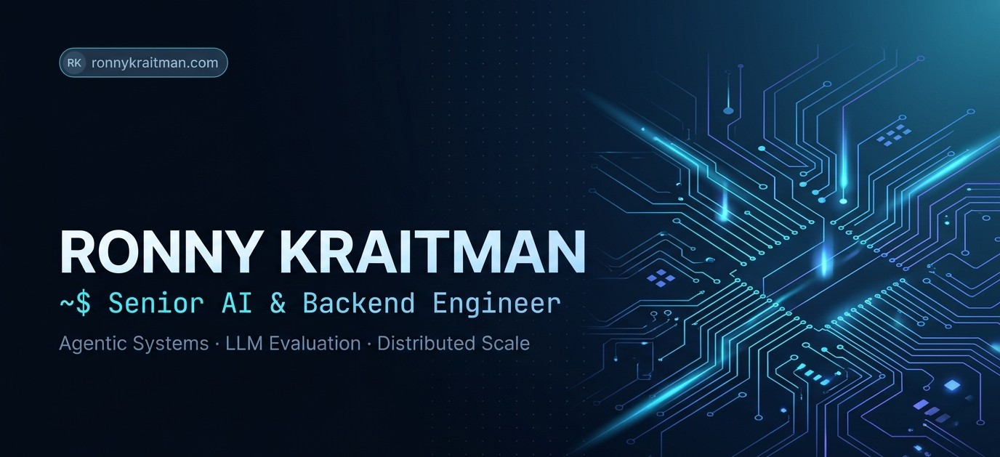
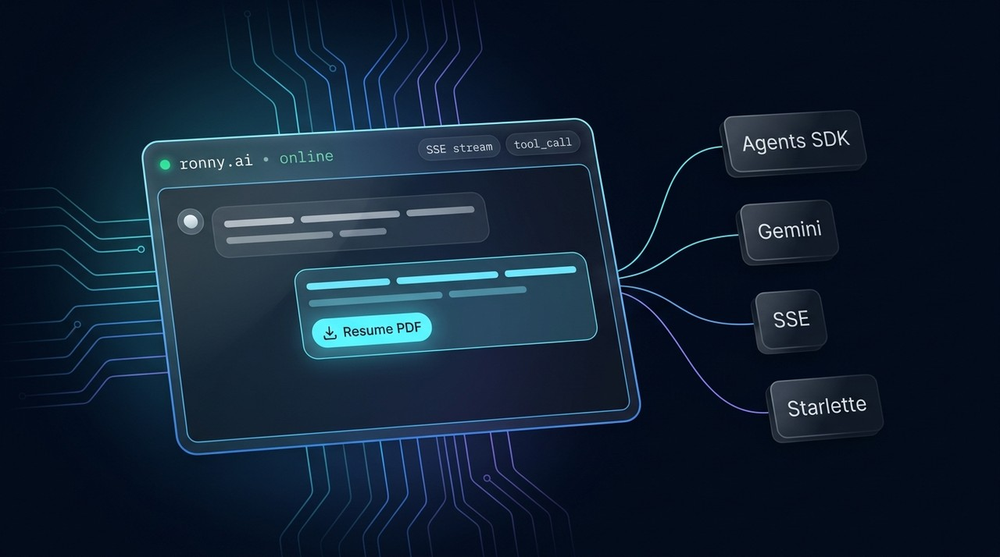
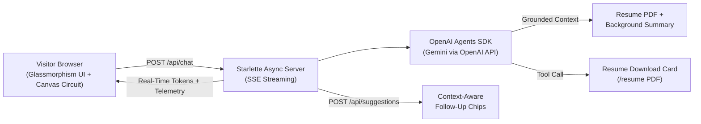
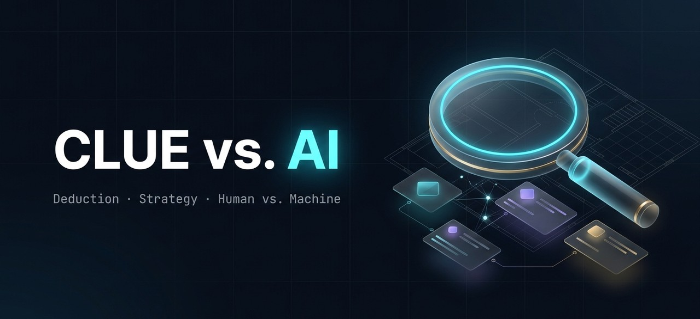

 
 

 
 

<i>"Any sufficiently advanced technology is indistinguishable from magic."</i> — Arthur C. Clarke

---

## 👋 About Me

Hey, I'm **Ronny Kraitman** — a **Senior AI & Backend Engineer** based in **Tel Aviv, Israel** (and an unabashed backend enthusiast who happily leaves CSS battles to the brave).

Over the past 5+ years at **Dynamic Yield**, my path has evolved from **QA Engineering** → **Big Data Development** → **Engineering Team Lead** → **AI Engineer**. Today, I architect and ship production-grade **agentic AI systems**, **LLM evaluation frameworks**, and **low-latency distributed backends** — turning experimental GenAI prototypes into reliable, revenue-generating products.

- 🧠 **Focus**: Multi-agent orchestration (`LangGraph`, `MCP`), RAG, LLM-as-a-Judge evals, and high-throughput Python/AWS backends.
- ⚡ **Engineering mindset**: Pragmatic system design grounded in real trade-offs — latency, token economics, observability, and zero-blocking scale.
- 🎧 **Off the clock**: Beach days, good wine (responsibly), great TV shows, and occasionally dancing while coding with music on.

 

---

## 🤖 About This Repository — [`ronny.ai`](https://ronnykraitman.com)

This repository powers **[ronnykraitman.com](https://ronnykraitman.com)** — an interactive portfolio and live **AI digital twin** that knows my engineering background, projects, and resume inside out.

  

 

### How It Works Under the Hood

| Layer | Highlights |
| :--- | :--- |
| **Agent Engine** | Built with the **OpenAI Agents SDK** backed by **Gemini** via the OpenAI compatibility endpoint, grounded strictly in my resume and technical background with tight anti-hallucination guardrails. |
| **Streaming API** | Lightweight **Starlette** async backend streaming tokens over **Server-Sent Events (SSE)** with live latency, TTFT, and token telemetry. |
| **Agentic UX** | Automatic tool calling for instant **PDF resume downloads**, JSON-schema-structured **context-aware follow-up chips** after every reply, and an interactive **intro video modal**. |
| **Frontend** | Zero-framework dark glassmorphism console with animated HTML5 canvas circuit pulses, Markdown + syntax highlighting, and mobile visual-viewport support. |

> 💬 **Try asking `ronny.ai` at [ronnykraitman.com](https://ronnykraitman.com):**
> - *"Walk me through the distributed architecture of your Consumer Agent."*
> - *"How do you benchmark and evaluate LLMs with `agentix-arena`?"*
> - *"How did you get SageMaker inference down to 20ms?"*
> - *"Can I grab your resume or contact details?"*

---

## 🚀 Featured Projects & Systems

<table>
  <tr>
    <td width="50%" valign="top">
      <h3>🛒 Autonomous E-Commerce Consumer Agent</h3>
      

        Production-grade, multi-turn shopping orchestration service engineered for high concurrency, low latency, and zero blocking.
      

      <ul>
        <li><b>Orchestration:</b> Stateful <code>LangGraph</code> router dispatching sub-tasks to async specialized worker agents.</li>
        <li><b>Tools & Discovery:</b> Modular e-commerce tool registry, hybrid <b>RAG</b> product discovery, and <b>MCP</b> integrations.</li>
        <li><b>Optimization:</b> Semantic LLM caching in <code>Redis</code>, prompt compression, token budgeting, and multilingual i18n attribute extraction.</li>
      </ul>
      <code>Python 3.12</code> · <code>FastAPI</code> · <code>LangGraph</code> · <code>MCP</code> · <code>RAG</code> · <code>Redis</code>
    </td>
    <td width="50%" valign="top">
      <h3>⚖️ <code>agentix-arena</code> &amp; LLM-as-a-Judge Harness</h3>
      

        Automated LLM benchmarking and quality-gate platform built on <b>AWS Bedrock</b> to evaluate foundation models before production rollout.
      

      <ul>
        <li><b>Streaming Benchmarks:</b> Side-by-side model comparisons across tokens/sec throughput, first-token latency, and accuracy.</li>
        <li><b>Quality Gates:</b> LLM-as-a-Judge evaluators quantifying hallucination rates, tool-call fidelity, and schema compliance.</li>
        <li><b>CI/CD Integration:</b> Golden-path <code>pytest</code> evaluation suites running against Bedrock endpoints prior to deployment.</li>
      </ul>
      <code>FastAPI</code> · <code>AWS Bedrock</code> · <code>pytest</code> · <code>LLM-as-a-Judge</code>
    </td>
  </tr>
  <tr>
    <td width="50%" valign="top">
      <h3>🧩 <code>agentiX</code> Platform &amp; Agentic QA Triage</h3>
      

        Internal AI platform foundations and autonomous developer tooling to accelerate production agent delivery across teams.
      

      <ul>
        <li><b>Service Templates:</b> Standardized <code>FastAPI</code> + <code>LangGraph</code> microservice templates and shared libraries with built-in telemetry.</li>
        <li><b>Autonomous Cypress Triage:</b> Agentic CI workflow using <code>LangGraph</code> + <code>MCP</code> to inspect failed test artifacts, diagnose environments, separate flakes from real bugs, and file actionable reports.</li>
      </ul>
      <code>LangGraph</code> · <code>MCP</code> · <code>FastAPI</code> · <code>OpenTelemetry</code> · <code>Langfuse</code>
    </td>
    <td width="50%" valign="top">
      <h3>📈 Real-Time User Behavior ML (SageMaker)</h3>
      

        High-scale predictive machine learning pipeline co-developed with Data Science from whiteboard design to production serving.
      

      <ul>
        <li><b>Data Pipelines:</b> Distributed feature processing, cleaning, and transformations at scale with <code>Spark</code> and <code>Airflow</code>.</li>
        <li><b>Training & Serving:</b> Automated training workflows on <b>AWS SageMaker</b> paired with a low-latency serving layer delivering <b>20ms</b> execution times.</li>
      </ul>
      <code>AWS SageMaker</code> · <code>Apache Spark</code> · <code>Airflow</code> · <code>Python</code> · <code>Java</code>
    </td>
  </tr>
</table>

---

## 🎮 Side Project — Are You Game?

  
   
   
  <b><a href="https://ronnykraitman.com/clue">Play Clue vs. AI →</a></b> 
  Put your deduction skills to the test in the classic mystery game — it's you against the AI.

---

## 🛠️ Core Stack

| Domain | Technologies |
| :--- | :--- |
| **Agentic AI & LLMs** | `LangGraph` · `LangChain` · `MCP` · `OpenAI Agents SDK` · `CrewAI` · `RAG` · `AWS Bedrock` · `Claude` · `Gemini` · `Ollama` |
| **Backend & Distributed** | `Python 3.12` · `FastAPI` · `Starlette` · `Java` · `Apache Spark` · `Kafka` · `Airflow` · `Kubernetes` · `Docker` · `Helm` |
| **Data & Storage** | `Redis` (state & semantic caching) · `PostgreSQL` · `DynamoDB` · `ScyllaDB` |
| **Observability & Evals** | `Langfuse` · `OpenTelemetry` · `Prometheus` · `Grafana` · `pytest` eval suites · `AWS SageMaker` |

---

## 📫 Let's Connect

Always happy to talk shop on **AI agents**, **LLM evaluation**, **distributed backends**, or interesting opportunities.

 

